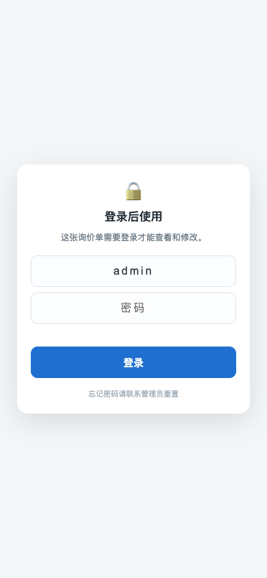
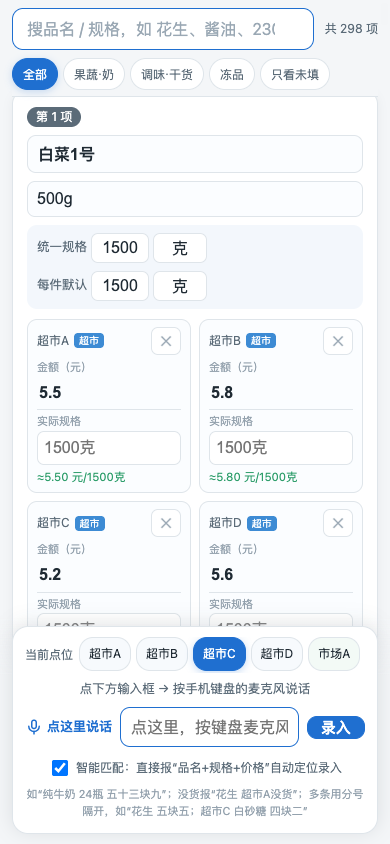
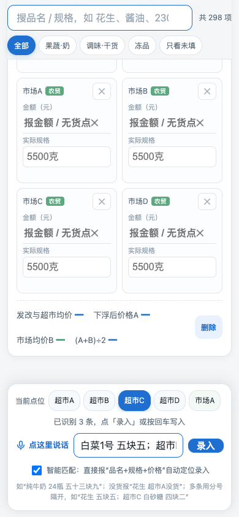
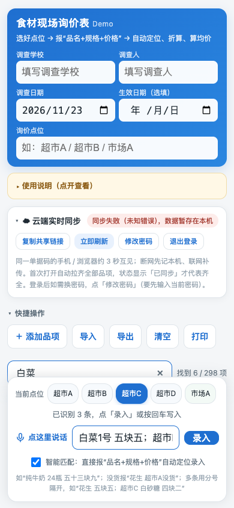
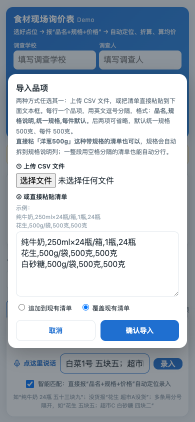
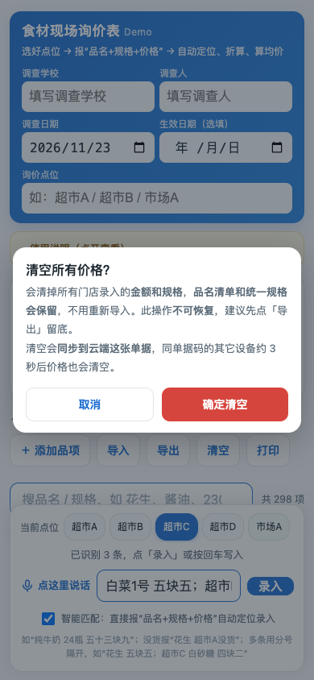

# 食材现场询价表 Demo

一个纯前端的询价录入工具：现场对着手机报「品名 + 价格」，自动解析填进表格，支持多门店比价、规格折算、均价计算、Excel 导出和多人实时同步。

> 这是脱敏后的演示版本：品名清单、门店名称、云端配置全部换成了示例数据，不含任何真实业务信息。

## 为什么做这个

给食堂 / 采购做询价，传统流程是：打印表格 → 跑几个市场抄价格 → 回办公室录入 Excel → 手算均价。一个市场跑下来几百个品项，光录入就要大半天，还容易抄错、算错。

这个工具把「录入」这一步搬到现场：看到价格直接说「白菜 五块五」，价格就进表了；几个店的价填完，均价、下浮价自动算好；收工点一下导出，直接是能交的 Excel。

## 快速开始

直接用浏览器打开 `index.html` 就能用。或者起个静态服务器：

```bash
python3 -m http.server 8000
# 浏览器打开 http://localhost:8000
```

**登录账号：`admin`　示例密码：`0000`**

默认不连云端（配置是占位符），页面会提示「同步失败，数据暂存在本机」，但录入、计算、导出、搜索、清空这些本地功能全部可用。

## 功能怎么用

下面每一项都配了真实界面截图，照着点就行。

### 1. 登录

打开页面先看到登录层，输入账号 `admin`、密码 `0000`，点「登录」进入。忘记密码演示版直接刷新或清浏览器缓存即可恢复。



### 2. 主界面与表头

顶部蓝色区域填调查信息：学校、调查人、调查日期、生效日期（可选）、询价点位。中间是「使用说明」折叠条，点一下展开完整操作提示。再往下是「云端实时同步」卡片和「快捷操作」栏（添加品项 / 导入 / 导出 / 清空 / 打印）。整张表就是一张可滚动的长列表，按分类筛选切换。


### 3. 录入价格与无货标记

每个品项是一张卡片，每家门店一个金额格。直接点格子手填金额；如果这家店没货，点金额框右上角的「✕」，该店会灰化、不计入均价，导出时显示「×」。实际规格和金额不一致时，在「实际规格」里填该店真实规格，工具自动折算成统一规格的单价（绿色字，如 `≈5.50 元/1500克`）。



### 4. 语音录入

底部固定一栏是语音区：点「点这里说话」调起键盘麦克风，说「白菜1号 五块五」，识别文字进输入框，点「录入」（或按回车）就自动拆出品名 + 金额填进对应格子。勾选「智能匹配」后，一句话里能同时带门店、品名、规格和价格，例如「超市B 白菜1号 五块八」会顺带切换点位。多条用分号隔开可一次录入多条。



每张卡片底部的四种价格——发改与超市均价、下浮后价格、市场均价、(A+B)÷2——都是自动算的，不用手算；不需要的品项点「删除」会二次确认，防误删。

### 5. 搜索与筛选

搜索框支持按品名、规格查找，输入「白菜」即时命中并显示「找到 6 / 298 项」。下方标签可按分类筛（全部 / 果蔬奶 / 调味干货 / 冻品 / 只看未填），方便集中补没录的项。



### 6. 批量导入品名

点「导入」，两种方式任选：上传 CSV 文件，或直接把清单粘贴进文本框。每行一项，用英文逗号分隔「品名,规格,统一规格,每件默认」，后两项可省略；也支持「纯牛奶,250ml×24瓶/箱,1箱,24瓶」这种带规格的清单，会自动拆列。选「追加到现有清单」或「覆盖现有清单」，点「确认导入」。



### 7. 清空价格

点「清空」会弹出二次确认。注意：只清掉各门店录入的金额和规格，**品名清单和统一规格保留**，不用重新导入；同单据码的其它设备约 3 秒后也会同步清空。此操作不可恢复，弹层里建议先「导出」留底。



### 8. 导出 Excel

点「导出」生成 17 列 `.xlsx`，按三个分类分工作表（果蔬奶 / 调味干货 / 冻品），无货项显示「×」，可直接交付。导出是纯前端手写 OOXML 生成的，不依赖任何第三方库。

### 9. 云端同步与登录管理

「云端实时同步」卡片里可以「复制共享链接」「立即刷新」「修改密码」「退出登录」。把带 `?sharecode=单据码` 的链接发给同事，大家打开就是同一张单据，约 3 秒互见；断网先记本机、联网自动补传。改密码要先验证当前密码，新密码同步到云端、所有设备下次登录生效；退出登录会清掉本机登录态、立即回到登录页。

## 技术栈

单个 HTML 文件，原生 JS，**零构建、零依赖**。

| 部分 | 实现 |
| --- | --- |
| 界面 | 原生 CSS（无框架），响应式适配手机 |
| 逻辑 | 原生 JavaScript，无打包工具 |
| 导出 | 手写 OOXML 直接生成 `.xlsx`，不依赖 SheetJS |
| 云端 | WorkBuddy Cloud SDK（可选，用于多人同步） |
| 密码 | Web Crypto SHA-256 + 随机盐 |

没有构建步骤，改完代码刷新浏览器就能看到效果。

## 启用云端同步（可选）

多人同步需要自己的云端环境：

1. 准备一个 WorkBuddy Cloud 应用，拿到 `endpoint` 和 `publishableKey`
2. 在云数据库建表 `survey_cells`，字段：`room`、`cell_key`、`cell_value`、`device_id`、`updated_at`
3. 建一个批量 upsert 的 RPC：`survey_upsert_cells(p_room, p_device, p_cells)`
4. 修改 `index.html` 里的配置：

```js
var CFG = {
  endpoint: 'https://your-app.app.workbuddy.host',
  oauthRelayBaseUrl: 'https://www.workbuddy.cn/v2/as/genie-baas/oauth',
  publishableKey: 'wbpk_your_app_id_your_key'
};
```

配置好后，把链接发给同事（带 `?sharecode=单据码`），大家打开就是同一张单据。

## 数据模型

整张表按「单元格」存，一行一个格子，方便增量同步和冲突合并：

| cell_key | 含义 |
| --- | --- |
| `item\|count` | 品项总数 |
| `item\|{i}\|name` | 第 i 项品名 |
| `item\|{i}\|spec` | 规格说明 |
| `item\|{i}\|baseVal` / `baseUnit` | 统一规格的值 / 单位 |
| `item\|{i}\|defVal` / `defUnit` | 每件默认的值 / 单位 |
| `amt\|{i}\|{store}` | 第 i 项在某门店的金额（`×` 表示无货） |
| `spec\|{i}\|{store}` | 第 i 项在某门店的实际规格 |
| `meta\|m-school` 等 | 表头字段（学校 / 调查人 / 日期 / 点位） |
| `meta\|password` | 登录密码，格式 `盐:SHA256(盐:密码)` |

同步策略：每 3 秒拉增量，只推变化的格子；首次打开全量分页拉齐，没拉完不显示「已同步」。

## 登录与权限

- 账号固定 `admin`，示例密码 `0000`（可在页面点「修改密码」修改，需先输入当前密码）
- 密码存云端 `meta|password`，加盐 SHA-256，所有设备共用同一个密码
- 未登录时**只读**：页面被登录层挡住，本地改动不会推送到云端
- 忘记密码需要在云端清掉 `meta|password` 记录，恢复为初始密码

**安全边界**：这是前端校验级别的锁，目的是防止无关人员误操作和乱改，不是加密。数据本身在云端仍可被读取，别拿它存真正机密的信息。

## 目录

```
index.html                      单文件应用（HTML + CSS + JS 全在里面）
README.md
docs/screenshots/               功能截图
  01-login.png                  登录
  02-overview.png               主界面总览
  03-card.png                   品项卡片 / 门店价格
  04-voice.png                  语音录入
  05-search.png                 搜索筛选
  06-import.png                 批量导入
  07-clear.png                  清空确认
```

## 说明

- 示例品名共 298 项，仅用于演示分类结构和导出格式，不含真实商品
- 门店名 `超市A~D`、`市场A~D` 为占位
- 未替换云端配置时，同步功能不可用，属正常现象

## License

MIT
